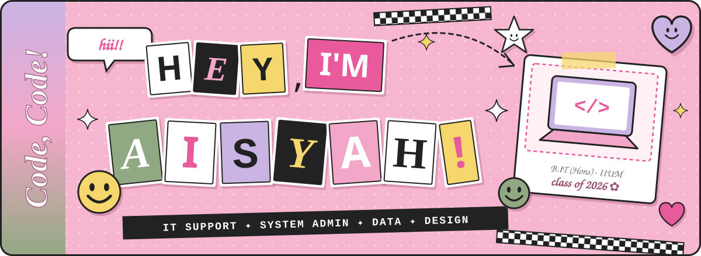
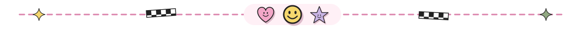
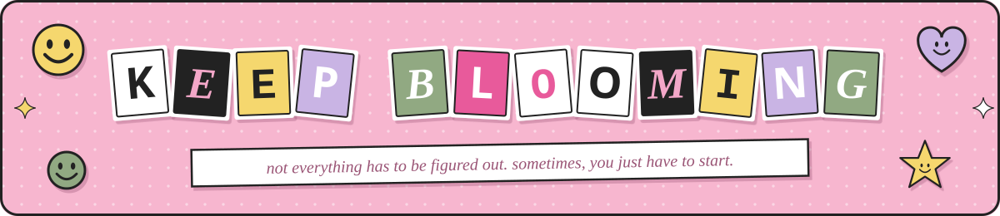

<div align="center">




<br/>


[](https://github.com/syahsunny?tab=followers)
[](https://github.com/syahsunny?tab=repositories)


</div>



## ☺ `ALL ABOUT` *me*

<table>
<tr>
<td width="60%" valign="top">

**Hii, I'm Aisyah!** 💌 welcome to my little scrapbook corner of GitHub.

I'm an **Information Technology graduate** who loves exploring the intersection of technology, creativity and innovation.

I enjoy making things, experimenting with ideas and finding ways to turn everyday problems into meaningful digital solutions.

</td>
<td width="40%" valign="top">

```yaml
Name:     Nurul 'Aisyah ✿
Based:    Kuala Lumpur, MY
Looking:  IT Support / SysAdmin
Speaks:   English, Malay
```

</td>
</tr>
</table>


## 🧰 MY `TOOLBOX` ✂️

*stickers i use to turn ideas into reality ↓*

<div align="center">

<table>
<tr>
<td align="center" width="33%">

**✿ code & dev**

<br/>


</td>
<td align="center" width="33%">

**🌷 data & databases**

 
<br/>
 
 


</td>
<td align="center" width="33%">

**🎨 design & productivity**

 
<br/>


</td>
</tr>
</table>

</div>


## 🎀 `LET'S` *connect!*

<div align="center">

<a href="https://www.linkedin.com/in/Syahsunny"></a>
<a href="mailto:aesyaniey@gmail.com"></a>
<a href="https://github.com/syahsunny"></a>

<br/><br/>



<sub>✂ ─ ─ ─ made with curiosity, creativity & a little bit of magic ─ ─ ─ ✂</sub>

</div>
