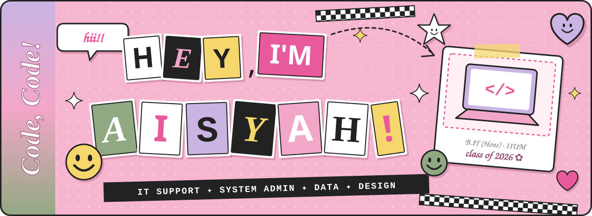
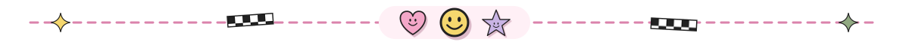
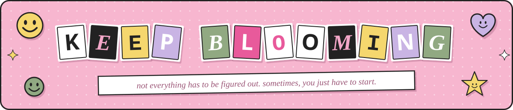

<div align="center">
  



<br/>


[](https://github.com/midnightshady?tab=followers)
[](https://github.com/midnightshady?tab=repositories)


</div>



## ☺ `A LITTLE` ~~ABOUT~~ **ALL ABOUT** *me*

<table>
<tr>
<td width="60%" valign="top">

**Hii, I'm Aisyah!** 💌 welcome to my little scrapbook corner of GitHub.

I'm an **Information Technology graduate** from IIUM with hands-on experience supporting **digitalisation, data management and corporate programmes** at **Tenaga Nasional Berhad** and **SME Corp. Malaysia**.

I love using digital tools for *data analysis*, *content creation* and *programme coordination* — and I'm excited to start my career in **IT Support or System Administration** 🚀 (happy to relocate anywhere in Malaysia!)

</td>
<td width="40%" valign="top">

```yaml
name:     Nurul 'Aisyah ✿
degree:   B.IT (Hons), IIUM
cgpa:     3.41
based:    Kuala Lumpur, MY
looking:  IT Support / SysAdmin
speaks:   English, Malay
```

</td>
</tr>
</table>


## 💼 `WHERE I'VE` *worked*

<table>
<tr>
<td width="50%" valign="top">

### ⚡ Tenaga Nasional Berhad
**Intern · Integrity Department**<br/>
<sub>📅 Mar 2026 – Sep 2026</sub>

- 📊 Managed & analysed training and e-learning data with **Excel, OneDrive & Tableau**
- 🎨 Designed infographics, posters & social media content
- 🎬 Produced videos and updated department website content
- 🤝 Helped run integrity programmes, webinars & campaigns

</td>
<td width="50%" valign="top">

### 🏢 SME Corp. Malaysia
**Intern · IT Development & Data Management**<br/>
<sub>📅 Sep 2021 – Feb 2022</sub>

- 🎬 Produced gimmick videos for **SMIDEX 2021**
- 📑 Contributed research to the **Annual Report 2020**
- 🖌️ Designed e-posters, brochures, infographics & logos
- 🎪 Supported event coordination for SMIDEX 2021

</td>
</tr>
</table>


## 🐾 `FEATURED` *project*

> ### 📺 Live Streaming Pet Donation App <sub>· Final Year Project, 2025</sub>
> A live-streaming donation platform that helps **feed shelter pets in real time** 🐶🐱
>
> - 🔌 Hooked up an **automatic food dispenser** to **TikTok Live Studio**
> - 🔥 Real-time donation tracking with **Firebase**
> - 📱 Admin control app built in **Flutter**


## 🧰 MY ~~little~~ `TOOLBOX` ✂️

*stickers i use to turn ideas into reality ↓*

<div align="center">

<table>
<tr>
<td align="center" width="33%">

**✿ code & dev**

<br/>
<br/>


</td>
<td align="center" width="33%">

**🌷 data & databases**

<br/>

<br/>


</td>
<td align="center" width="33%">

**🎨 design & productivity**

<br/>

<br/>


</td>
</tr>
</table>

</div>


## 🎓 `SCHOOL` *days* & 🏆 `PROUD` *moments*

| | |
|:---:|:---|
| 🎓 | **Bachelor of IT (Hons)** — International Islamic University Malaysia · *2022 – 2026* · CGPA **3.41** |
| 📘 | **Diploma in IT** — Politeknik Ungku Omar · *2019 – 2022* · CGPA **3.81** |
| 🏅 | **Head of Department Award** — Semester 2, 2019/2020 (Diploma in IT) |
| 🥈 | **Silver Award** — 6th University in Action Symposium |
| 🤝 | Committee member for TNB, SPRM & SMIDEX programmes · Innovatex Tech Expo participant *(2024 & 2025)* |


## 📸 SNAPSHOTS of my `GITHUB`

<div align="center">


</div>


## 🎀 `LET'S` *connect!*

<div align="center">

<a href="https://www.linkedin.com/in/Syahsunny"></a>
<a href="mailto:aesyaniey@gmail.com"></a>
<a href="https://github.com/midnightshady"></a>

<br/><br/>



<sub>✂ ─ ─ ─ made with curiosity, creativity & a little bit of magic ─ ─ ─ ✂</sub>

</div>
